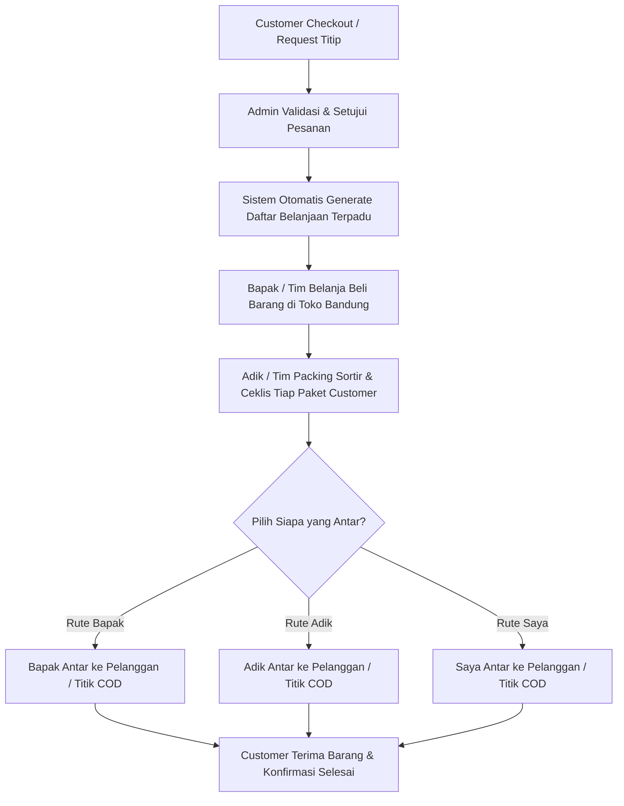

# BLUEPRINT SISTEM JASTIP BANDUNG
*(Sistem Operasional Jasa Titip Keluarga - Internal Delivery)*

---

## 1. Ringkasan & Karakteristik Bisnis
* **Model Bisnis:** Jasa Titip (Jastip) produk dan kuliner khas Bandung (oleh-oleh, kue, makanan, distro/fashion, dll).
* **Tim Operasional:** Dikelola internal oleh 3 orang (Keluarga: Saya, Bapak, Adik).
* **Model Logistik:** 
  * **Tanpa pihak ketiga** (tanpa JNE, J&T, SiCepat, dll).
  * **Tanpa nomor resi pengiriman.**
  * Pengantaran fleksibel: Diantar langsung oleh tim (Bapak/Adik/Saya), COD (Cash on Delivery), atau titik kumpul (*meeting point*).

---

## 2. Tech Stack Terpilih
* **Backend:** PHP Native Murni (Struktur modular/clean procedural & OOP ringan, PDO MySQL, Session Auth).
* **Frontend:** HTML5, Tailwind CSS, JavaScript (Vanilla JS).
* **Database:** MySQL (XAMPP).
* **Desain UI:** Mobile-first responsive (karena Bapak & Adik akan sering akses lewat HP saat belanja/antar).

---

## 3. Revisi Pemetaan Peran & Hak Akses (Role-Based Access)

Sistem dibagi menjadi **4 Peran (Role)**:

### 👤 Role 1: Super Admin / Owner (Saya)
* **Tanggung Jawab:** Manajemen platform, keuangan, katalog, dan pengawasan alur kerja.
* **Hak Akses:**
  * Kelola Master Data: Produk, Kategori, Open PO (Batch belanja).
  * Konfirmasi pesanan & verifikasi pembayaran DP / Lunas.
  * Menugaskan pembagian tugas belanja & pengantaran (ke Bapak atau Adik).
  * Laporan rekapitulasi belanja harian, total omzet, biaya operasional, dan fee jastip.
  * Mengelola akun user internal (Bapak, Adik).

### 🛍️ Role 2: Tim Lapangan / Belanja & Pengantar (Bapak)
* **Tanggung Jawab:** Belanja langsung ke toko/pasar di Bandung dan pengantaran ke pelanggan di rute yang ditentukan.
* **Hak Akses (Tampilan Simpel Mobile-Friendly):**
  * **Shopping List (Daftar Belanja Terkonsolidasi):** Melihat total barang yang harus dibeli per toko/lokasi (contoh: *Bolu Susu Lembang Rasa Keju x 5 box*).
  * Update status item belanja: `Sudah Dibeli` / `Stok Kosong` / `Diganti Alternatif`.
  * Input catatan harga beli riil / upload struk belanja.
  * **Delivery List:** Melihat daftar pelanggan yang menjadi tugas antarnya (Nama, Nomor WhatsApp + tombol klik chat, Titik Antar/Alamat, Titik Temu/Peta).
  * Update status pengiriman: `Sedang Meluncur Antar` ➡️ `Selesai / Sudah Diterima`.

### 📦 Role 3: Tim Operasional / Packing & Pengantar (Adik)
* **Tanggung Jawab:** QC barang belanjaan, sortir & packing per customer, antar pesanan lokal, dan follow-up CS sederhana.
* **Hak Akses (Tampilan Simpel Mobile-Friendly):**
  * **Packing Checklist:** Cek kelengkapan barang belanjaan per pelanggan sebelum dibungkus.
  * Update status pesanan: `Sudah Dipacking & Siap Antar`.
  * **Delivery List:** Melihat dan memperbarui pesanan yang diantarkan oleh Adik.
  * Update status: `Sedang Diantar` ➡️ `Selesai / Sudah Diterima`.

### 🛒 Role 4: Customer / Pelanggan
* **Tanggung Jawab:** Membuat pesanan titip barang dan membayar.
* **Hak Akses:**
  * Eksplorasi katalog barang / jadwal Open PO yang sedang buka.
  * Request titip barang custom (Form: Nama barang, foto referensi, estimasi harga, nama toko di Bandung).
  * Checkout: Masukkan alamat pengantaran / request titik temu COD + nomor WhatsApp.
  * **Pelacakan Status Real-time (Tanpa Resi):**
    1. ⏳ *Menunggu Konfirmasi Pesanan & Pembayaran*
    2. 📝 *Pesanan Dikonfirmasi & Dijadwalkan Belanja*
    3. 🛒 *Barang Sedang Dibelanjakan di Toko*
    4. 📦 *Barang Sudah Lengkap & Selesai Dipacking*
    5. 🛵 *Sedang Diantar Menuju Lokasi Anda (oleh Tim Jastip)*
    6. ✅ *Pesanan Telah Diterima (Selesai)*

---

## 4. Alur Kerja Logistik Fleksibel (Tanpa Pihak Ketiga)



---

## 5. Rencana Struktur Database (Ringkas & Efisien)

1. `users` (id, nama, no_hp, username, password, role: `admin`, `shopper`, `packer_courier`, `customer`, created_at)
2. `categories` (id, nama_kategori, slug)
3. `products` (id, category_id, nama_produk, nama_toko, harga_asli, fee_jastip, foto, status_tersedia)
4. `orders` (id, kode_order, user_id, tanggal_pesan, metode_pengantaran: `antar_alamat`/`cod`, alamat_lengkap, catatan_titip, total_bayar, status_pembayaran, status_pesanan, kurir_internal_id)
5. `order_items` (id, order_id, product_id, custom_item_name, qty, harga_satuan, fee_satuan, status_item: `menunggu`, `dibeli`, `kosong`)
6. `order_logs` (id, order_id, status, catatan, updated_by, created_at)

---

## 6. Struktur Direktori Proyek (PHP Native Bersih)

```text
JastipBandung/
├── .git/
├── .gitignore
├── README.md
├── BLUEPRINT_JASTIP_BANDUNG.md
├── VIBE_CODING_GIT_WORKFLOW.md
├── config/
│   ├── database.php        # Koneksi PDO MySQL
│   ├── app.php             # Konfigurasi konstanta URL, fee default
│   └── helper.php          # Fungsi format rupiah, tanggal, auth check
├── assets/
│   ├── css/                # Tailwind CSS (Output / CDN Setup)
│   ├── js/                 # Javascript interaktif
│   └── images/             # Asset gambar statis
├── uploads/                # Foto produk & struk belanja
├── includes/
│   ├── header.php          # Navbar & Head
│   ├── footer.php          # Footer & Script
│   └── auth_guard.php      # Proteksi role & session
├── views/
│   ├── auth/               # Login, Register
│   ├── customer/           # Katalog, Keranjang, Tracking Order
│   ├── admin/              # Dashboard Super Admin, Rekap Finansial
│   ├── shopper/            # Dashboard Belanja (Bapak)
│   └── courier/            # Dashboard Packing & Antar (Adik)
└── index.php               # Landing Page & Router sederhana
```

