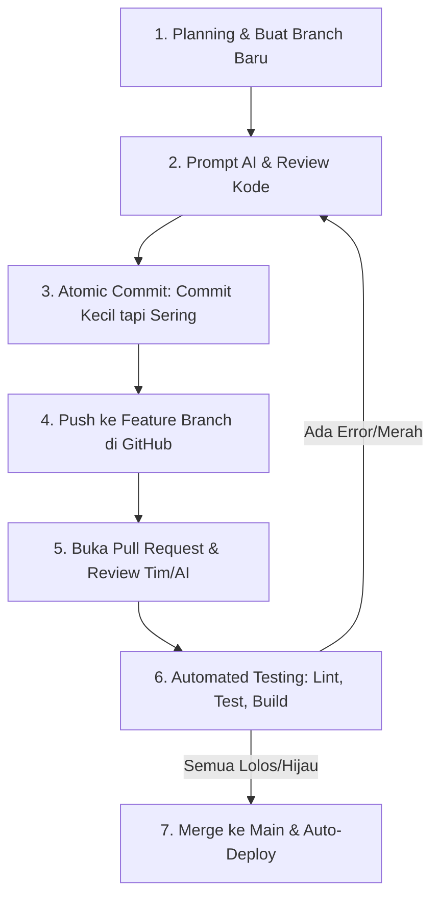

# Panduan Workflow Vibe Coding: AI x Git Best Practices

> *"AI bikin kamu ngoding lebih cepat, Git bikin kamu nggak panik."*

Dokumen ini disusun dari hasil telaah materi audio mengenai alur kerja (*workflow*) yang benar, aman, dan profesional saat melakukan **Vibe Coding** (ngoding dibantu AI).

---

## 🎯 Masalah Utama (*The Anti-Pattern*)

Banyak developer pemula atau antusias AI terjebak dalam pola:
```
Prompt AI ➡️ Kode Jadi ➡️ Langsung Push ke `main` ➡️ 💥 SISTEM HANCUR
```

**Kenapa ini berbahaya?**
1. **Halusinasi AI:** AI sering kali percaya diri memberikan kode yang tampak benar, padahal merusak dependensi atau logika lain.
2. **Regression Bug:** Fitur baru selesai, tetapi fitur lama yang sebelumnya normal mendadak rusak (*broken*).
3. **Tanpa Rem Pengaman:** Jika langsung ditimpa di branch utama (`main`), proses mengembalikan sistem ke kondisi stabil menjadi mimpi buruk.

---

## 🚀 6 Langkah Workflow yang Benar (SOP)



---

### 1. Plan Dulu (Jangan Langsung Gas Prompt)
* **Aturan:** Sebelum mengetik perintah apa pun ke AI, definisikan dulu fitur yang ingin dibangun.
* **Tindakan Teknis:**
  * Catat poin-poin fitur, input, output, dan batasannya (*scope*).
  * Pastikan repositori bersih dan file sensitif sudah masuk `.gitignore`.
  * **Wajib buat branch baru**:
    ```bash
    git checkout -b feature/nama-fitur
    ```
  * ⚠️ *Jangan pernah ngoding fitur baru langsung di branch `main`.*
* **Tujuan:** Mencegah AI "ngarang bebas" dan menjaga basis kode utama tetap stabil.

---

### 2. Commit Kecil tapi Sering (*Atomic Commits*)
* **Aturan:** Terapkan prinsip satu bagian kecil jalan, baca kodenya, langsung commit.
* **Tindakan Teknis:**
  * Jangan menumpuk perubahan ratusan baris sekaligus.
  * Baca dan pahami kode yang dihasilkan AI sebelum menyimpannya:
    ```bash
    git add .
    git commit -m "feat: implementasi fungsi validasi form login"
    ```
* **Tujuan:** Sebagai **checkpoint save game**. Ketika AI berikutnya merusak sesuatu, Anda tidak perlu frustrasi mencari sumber error:
  ```bash
  # Cukup kembalikan ke checkpoint commit terakhir yang sehat
  git reset --hard HEAD~1
  ```

---

### 3. Push ke Branch Sendiri (Bukan ke `main`)
* **Aturan:** Simpan progres kerja ke remote repository secara berkala.
* **Tindakan Teknis:**
  ```bash
  git push origin feature/nama-fitur
  ```
* **Tujuan:** 
  * Kode tersimpan aman di cloud (GitHub/GitLab).
  * Menghindari kehilangan progres jika sewaktu-waktu laptop mati mendadak atau terjadi kerusakan hardware.

---

### 4. Buka Pull Request (PR)
* **Aturan:** Jadikan PR sebagai pintu saringan sebelum kode bergabung ke `main`.
* **Tindakan Teknis:**
  * Buat PR dari `feature/nama-fitur` menuju `main`.
  * Libatkan rekan tim (*peer review*) atau pasang *AI Code Reviewer* (misalnya: GitHub Copilot PR Reviewer, CodeRabbit).
* **Tujuan:** Menangkap bug logika, celah keamanan, atau inkonsistensi arsitektur sebelum dirilis.

---

### 5. Biarkan Robot yang Mengetes (*Automated CI Pipeline*)
* **Aturan:** Setiap kali ada PR terbuka, biarkan server otomatis (Continuous Integration) menjalankan pengujian:
  1. **Linter:** Memastikan standar penulisan kode seragam dan bersih.
  2. **Unit / Integration Tests:** Memastikan logika fungsi berjalan sesuai ekspektasi.
  3. **Build:** Memastikan proyek bisa dikompilasi tanpa gagal.
* **Aturan Warna Indikator:**
  * 🔴 **Merah (Failed):** Dilarang keras dimerge. Minta AI memperbaiki bagian yang gagal.
  * 🟢 **Hijau (Passed):** Aman dan memenuhi kriteria kualitas.

---

### 6. Merge ke `main` & Auto-Deploy (CD)
* **Aturan:** Gabungkan (*merge*) hanya ketika seluruh review dan tes sudah lolos 100%.
* **Tindakan Teknis:**
  * Lakukan merge di GitHub/GitLab.
  * Pipeline Continuous Deployment (CD) akan otomatis mempublikasikan aplikasi ke server produksi.
* **Tujuan:** Memberikan jaminan bahwa setiap baris kode yang sampai ke tangan user adalah kode yang sudah teruji, stabil, dan aman.

---

## 📌 Ringkasan Cepat (Cheat Sheet)

| Komponen | Peran Analogi | Fungsi Nyata |
| :--- | :--- | :--- |
| **AI (Claude / Gemini)** | **Pedal Gas (Akselerator)** | Mempercepat penulisan boilerplate & implementasi logika |
| **Git Branch & Commit** | **Checkpoint Save Game** | Tempat berlindung dan titik mundur saat AI membuat error |
| **Pull Request (PR)** | **Pintu Sensor / Kurasi** | Memastikan ada mata kedua yang memverifikasi kode |
| **CI/CD Pipeline** | **Satpam Penguji Otomatis** | Menjamin tidak ada kode rusak yang lolos ke server live |

---
*File ini dibuat otomatis sebagai panduan standar kerja pengembangan software berbasis AI.*

