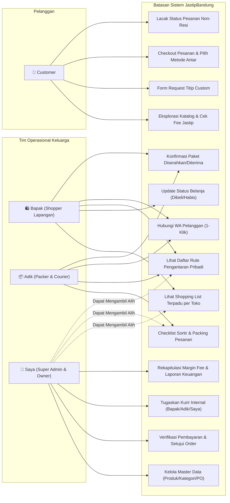
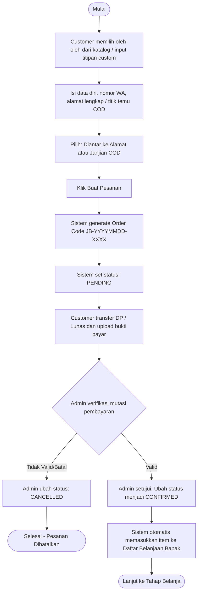
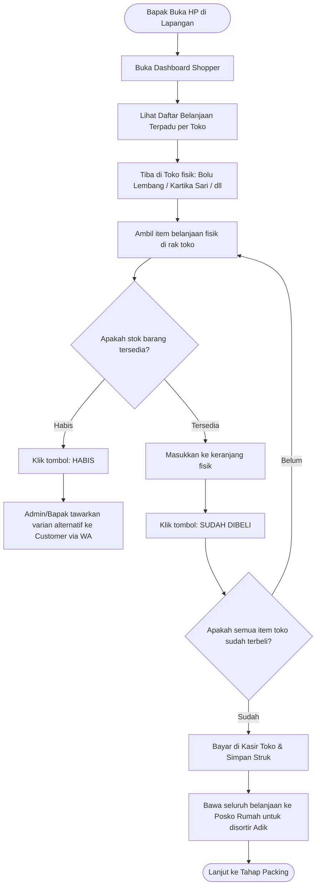
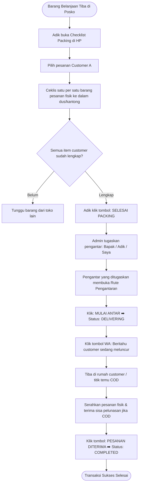
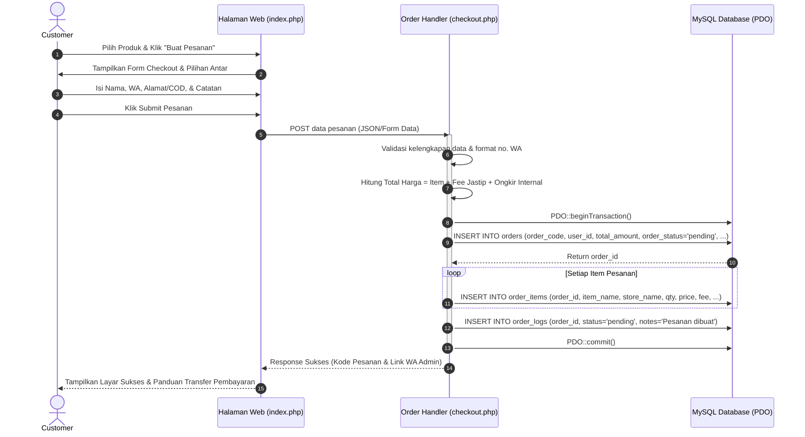
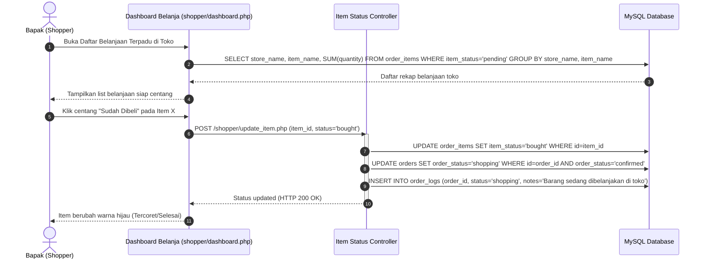
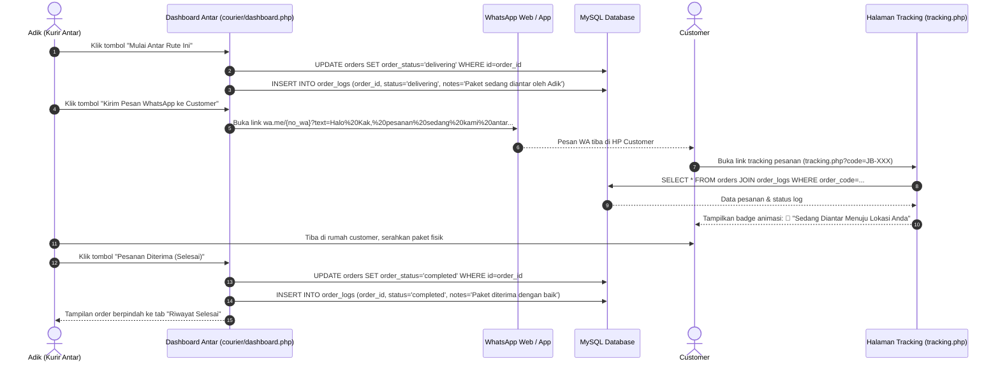
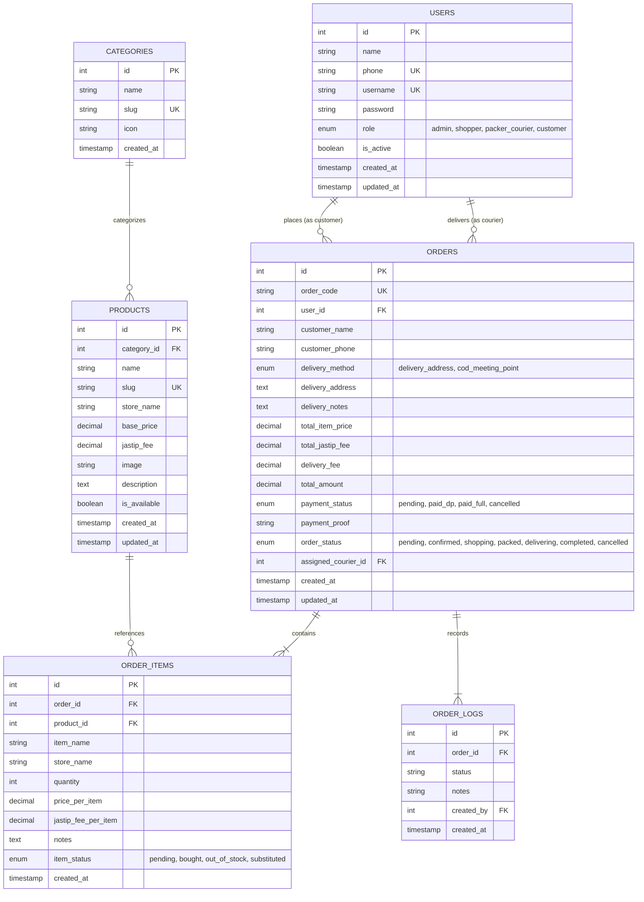
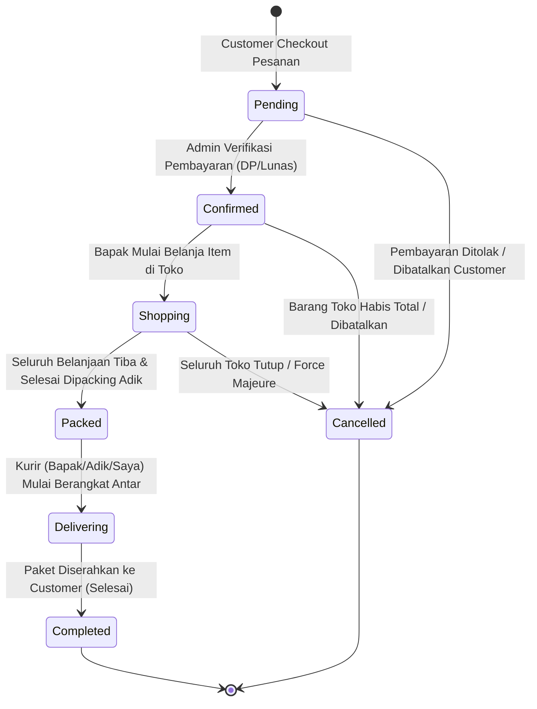

# DOKUMEN DESAIN PERANGKAT LUNAK (UML SPECIFICATIONS)
## Sistem Informasi Operasional JastipBandung
*Standard: Unified Modeling Language (UML 2.5) with Mermaid Diagram Support*

---

## 1. USE CASE DIAGRAM (DIAGRAM USE CASE)

### 1.1 Diagram Global Use Case Sistem

---

## 2. ACTIVITY DIAGRAMS (DIAGRAM AKTIVITAS)

### 2.1 Activity 1: Alur Pemesanan & Verifikasi Pembayaran (Customer & Admin)

---

### 2.2 Activity 2: Alur Belanja Konsolidasi di Toko Bandung (Bapak)

---

### 2.3 Activity 3: Alur Sortir, Packing & Pengantaran Mandiri (Adik & Customer)

---

## 3. SEQUENCE DIAGRAMS (DIAGRAM URUTAN)

### 3.1 Sequence 1: Proses Checkout Pesanan oleh Customer

---

### 3.2 Sequence 2: Update Item Belanja oleh Bapak (Shopper)

---

### 3.3 Sequence 3: Pengantaran Mandiri & Pelacakan Real-time (Adik & Customer)

---

## 4. ENTITY RELATIONSHIP DIAGRAM (ERD & CLASS SPECIFICATION)

---

## 5. STATE MACHINE DIAGRAM (STATUS PESANAN NON-RESI)

